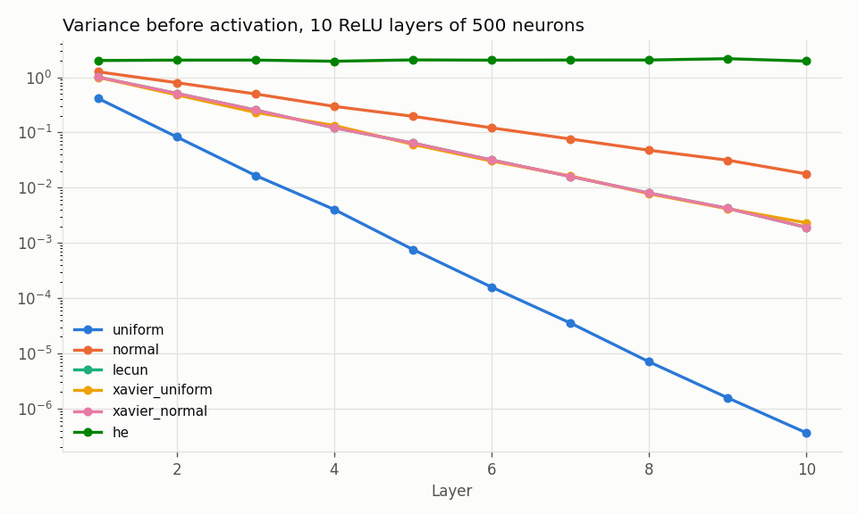
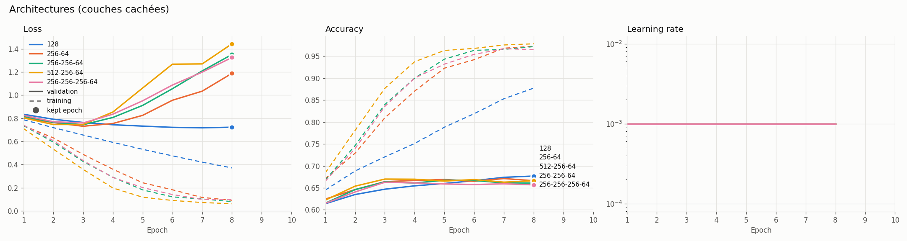
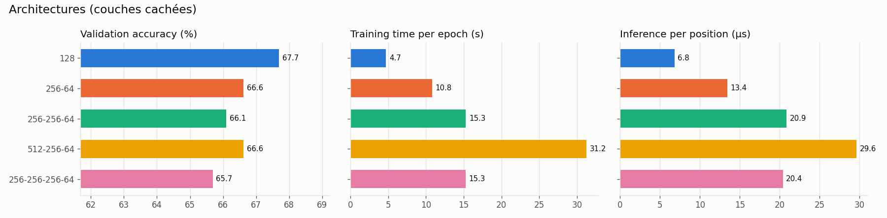
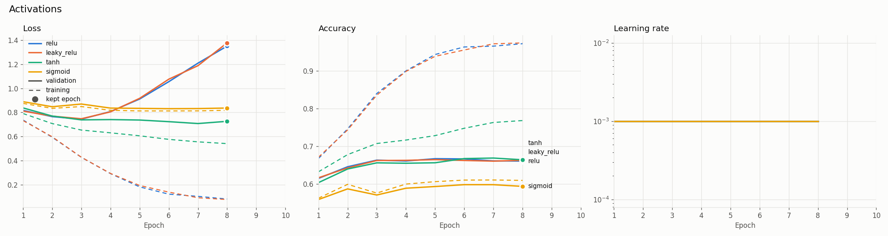
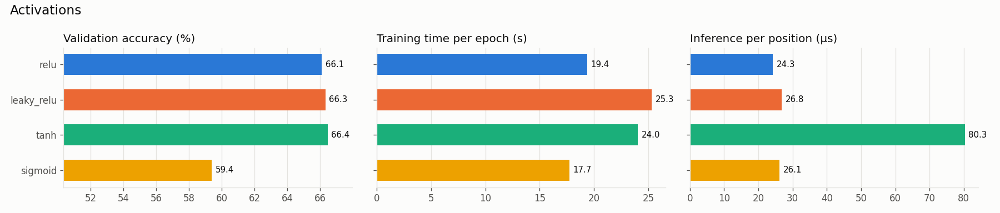
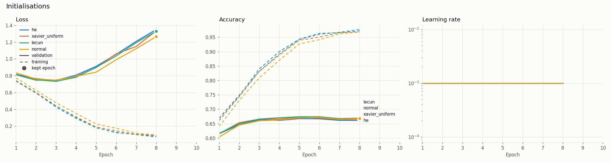
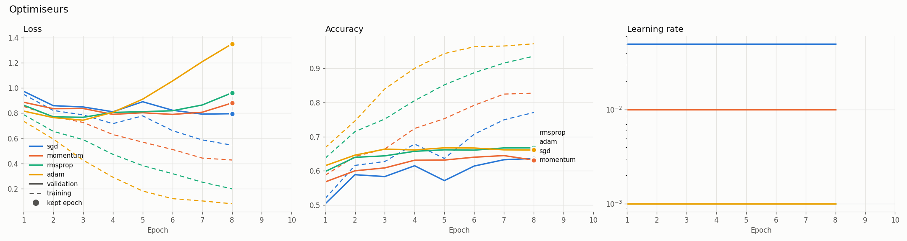
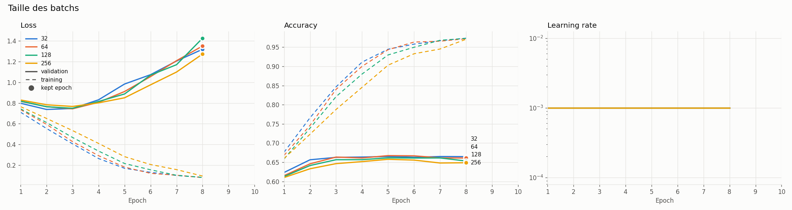
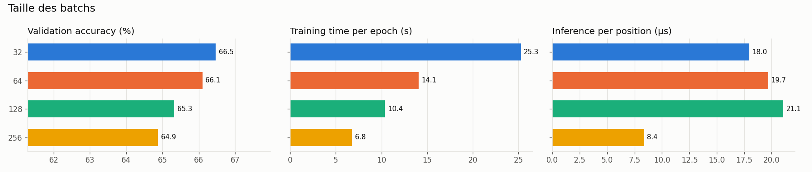
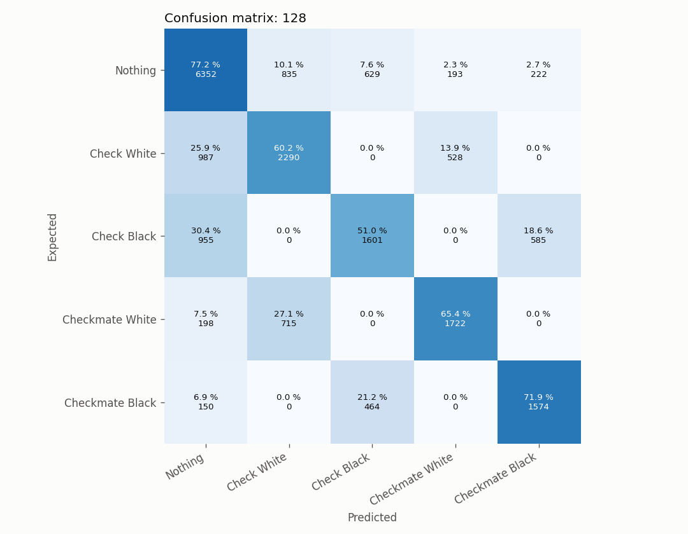

# Les benchmarks

Ce document compare les choix possibles pour le réseau d'échecs, toujours dans les mêmes conditions, avec des graphiques à l'appui : l'architecture, l'activation, l'initialisation, l'optimiseur et la taille des batchs. Il mesure aussi les deux affirmations de [notre choix du langage](choix_du_langage.md) : la vitesse de NumPy, et l'effet de la taille des batchs sur le temps d'entraînement.

Les effets de [la régularisation L2 et de l'early stopping](regularisation.md), [du dropout](dropout.md) et [du learning rate planifié](learning_rate.md) sont mesurés sur le dataset complet, dans leurs propres documents. [La recherche d'hyperparamètres](recherche.md) explore toutes ces dimensions à la fois.

## La méthode

```
$> python3 -m scripts.benchmark --benchmark configs/benchmarks/activations.toml \
       --train datasets/official_train.txt --validation datasets/official_validation.txt \
       --train-size 60000 --validation-size 20000 --epochs 8 --json datasets/activations.json
$> python3 -m scripts.plot_benchmark --json datasets/activations.json \
       --output docs/images/benchmarks/activations
```

- **Une seule chose change à la fois.** Chaque benchmark de [configs/benchmarks/](../configs/benchmarks) liste ses variantes. Une variante ne change que les valeurs qu'elle nomme : tout le reste vient de la configuration du réseau poussé, [configs/my_torch_network.conf](../configs/my_torch_network.conf).
- **Les mêmes données pour toutes les variantes :** 60 000 positions d'entraînement et 20 000 de validation, tirées une fois pour toutes, avec une graine, du dataset fourni avec le sujet. Ce n'est qu'un dixième du jeu d'entraînement, pour que chaque variante ne prenne que quelques minutes : les précisions sont donc plus basses que celles du réseau poussé, et c'est leur comparaison qui compte.
- **Le même nombre d'epochs,** 8, sans early stopping : toutes les courbes ont la même longueur.
- **Les mesures :** la précision et le F1 sur la validation, la matrice de confusion, le temps d'entraînement par epoch, et le temps de prédiction par position. Les temps sont pris sur la même machine, mais elle faisait parfois autre chose en même temps : seuls les écarts nets comptent.

Chaque benchmark donne trois images : les courbes d'apprentissage de toutes les variantes sur un même graphique, un résumé en barres, et la matrice de confusion de la meilleure variante.

## La stabilité du signal selon l'initialisation

Avant même d'entraîner, l'initialisation décide si le signal traverse un réseau profond. [scripts/signal_by_initializer.py](../scripts/signal_by_initializer.py) fait passer 1 000 entrées aléatoires dans 10 couches ReLU de 500 neurones, et mesure la variance des valeurs avant chaque activation :

```
$> python3 -m scripts.signal_by_initializer --output docs/images/benchmarks/signal.png
```

| Initialisation | Couche 1 | Couche 5 | Couche 10 |
|---|---|---|---|
| `uniform` | 0,42 | 0,00076 | 0,00000037 |
| `normal` | 1,26 | 0,20 | 0,018 |
| `lecun` | 1,00 | 0,064 | 0,0019 |
| `xavier_uniform` | 1,00 | 0,061 | 0,0023 |
| `xavier_normal` | 1,00 | 0,064 | 0,0019 |
| `he` | 2,01 | 2,06 | 1,96 |



- **Avec `he`, la variance reste stable,** autour de 2, jusqu'à la dixième couche. Sa variance `2 / entrées` compense exactement ReLU, qui met à zéro la moitié des valeurs.
- **Avec `lecun` et `xavier`, elle est divisée par 2 à chaque couche,** soit par environ 500 sur 10 couches. Elles ont été conçues pour des activations symétriques comme `tanh`, qui ne perdent pas la moitié du signal. Sur ces couches carrées, `lecun` et `xavier_normal` donnent exactement la même variance.
- **Avec `uniform`, le signal disparaît presque,** divisé par plus d'un million.

Un signal qui s'éteint dans le forward s'éteint aussi dans le backward : les premières couches ne reçoivent presque plus de gradient, et apprennent très lentement. C'est pourquoi `he` est l'initialisation par défaut de `my_torch`, avec ReLU. Le benchmark des initialisations, plus bas, mesure si cela se voit aussi sur le réseau d'échecs, qui n'a que 3 couches cachées.

## La vitesse de NumPy

[scripts/numpy_speed.py](../scripts/numpy_speed.py) chronomètre le produit le plus coûteux d'un pas d'entraînement : le forward de la première couche, un batch de 64 positions de 769 entrées par 256 neurones, soit 25 millions d'opérations. Il le compare à une triple boucle écrite en Python, après avoir vérifié que les deux donnent le même résultat :

```
$> python3 -m scripts.numpy_speed
(64 x 769) @ (769 x 256): 25,198,592 operations
naive Python:    870.950 ms (0.029 Gflop/s)
NumPy:             0.238 ms (105.836 Gflop/s)
NumPy is 3,658 times faster
```

| Produit | Temps | Débit |
|---|---|---|
| Triple boucle en Python | 871 ms | 0,03 Gflop/s |
| NumPy, sur un seul cœur (`OPENBLAS_NUM_THREADS=1`) | 0,68 ms | 37 Gflop/s |
| NumPy, sur les 8 cœurs | **0,24 ms** | **106 Gflop/s** |

**NumPy est environ 3 600 fois plus rapide,** et encore 1 300 fois sur un seul cœur. La différence ne vient donc pas seulement du parallélisme : NumPy confie le produit à BLAS, du code compilé qui utilise les instructions vectorielles du processeur et sa mémoire cache. Avec la triple boucle, une seule epoch du réseau poussé prendrait plusieurs heures au lieu de quelques minutes. C'est ce que promettait [le choix du langage](choix_du_langage.md) : ce n'est pas Python qui calcule, c'est BLAS.

## Les architectures

[configs/benchmarks/architectures.toml](../configs/benchmarks/architectures.toml) change les couches cachées, toutes en ReLU.

| Couches cachées | Paramètres | Entraînement | Validation | Temps par epoch |
|---|---|---|---|---|
| `128` | 99 205 | 87,7 % | **67,7 %** | 4,7 s |
| `256-64` | 213 893 | 97,3 % | 66,6 % | 10,8 s |
| `256-256-64` (réseau poussé) | 279 685 | 97,2 % | 66,1 % | 15,3 s |
| `512-256-64` | 542 341 | 97,8 % | 66,6 % | 31,2 s |
| `256-256-256-64` | 345 477 | 96,5 % | 65,7 % | 15,3 s |





- **Sur 60 000 positions, tous les réseaux à plusieurs couches overfittent dès l'epoch 3 :** leur coût de validation remonte, alors qu'ils atteignent 97 % sur l'entraînement. Le réseau `128` apprend moins bien l'entraînement, et c'est pour cela qu'il garde la meilleure validation.
- **Avec tout le dataset, c'est l'inverse :** [la recherche d'hyperparamètres](recherche.md) a entraîné un réseau `128` sur les 572 449 positions, et il plafonne à 81,5 % de validation, contre 89,07 % pour `256-256-64`. Avec plus de données, la capacité des grands réseaux devient utile. Le choix de l'architecture du réseau poussé s'appuie donc sur [la comparaison faite sur tout le dataset](reseau_final.md#le-choix-de-la-configuration), pas sur ce benchmark.
- **Le temps par epoch suit le nombre de paramètres :** doubler la première couche, de 256 à 512 neurones, double le temps.

## Les activations

[configs/benchmarks/activations.toml](../configs/benchmarks/activations.toml) change l'activation des trois couches cachées.

| Activation | Entraînement | Validation | F1 macro |
|---|---|---|---|
| `relu` | 97,2 % | 66,1 % | 0,640 |
| `leaky_relu` | 97,4 % | 66,3 % | 0,636 |
| `tanh` | 76,8 % | 66,4 % | 0,636 |
| `sigmoid` | 61,0 % | **59,4 %** | 0,539 |





- **`sigmoid` est nettement moins bonne,** 7 points sous les autres. Sa dérivée vaut au plus 0,25 : à chaque couche, le gradient est au moins divisé par 4, et les premières couches apprennent à peine. Elle n'apprend même pas l'entraînement, 61 %.
- **`relu`, `leaky_relu` et `tanh` sont à égalité en validation,** à 0,3 point près, ce qui est dans le bruit d'une mesure sur 20 000 positions. `tanh` apprend beaucoup moins l'entraînement, 76,8 % contre 97 % : elle overfitte moins dans ces conditions, mais elle était aussi nettement moins bonne dans [la recherche](recherche.md), avec 62,2 % en moyenne.
- **`relu` reste le choix du réseau poussé :** aussi bonne que les autres, la plus simple à calculer, et la seule pour laquelle l'initialisation `he` est conçue. La pente de 0,01 de `leaky_relu` n'apporte rien de mesurable ici.

## Les initialisations

[configs/benchmarks/initializers.toml](../configs/benchmarks/initializers.toml) change l'initialisation des poids.

| Initialisation | Entraînement | Validation | F1 macro |
|---|---|---|---|
| `he` (réseau poussé) | 97,2 % | 66,1 % | 0,640 |
| `xavier_uniform` | 96,8 % | 66,6 % | 0,637 |
| `lecun` | 97,7 % | 66,9 % | 0,643 |
| `normal` | 96,8 % | 66,8 % | 0,640 |



**Les quatre initialisations sont à égalité,** à 0,9 point près. Avec seulement 3 couches cachées et Adam, la perte de signal de `lecun` ou `xavier`, divisée par 2 par couche comme le montre [la stabilité du signal](#la-stabilité-du-signal-selon-linitialisation), reste faible, et Adam compense la taille des gradients paramètre par paramètre. L'écart mesuré sur 10 couches ne se voit pas sur ce réseau peu profond. `he` reste le choix par défaut, car c'est celle qui garde le signal stable quelle que soit la profondeur.

## Les optimiseurs

[configs/benchmarks/optimizers.toml](../configs/benchmarks/optimizers.toml) change l'optimiseur, chacun avec un learning rate habituel pour lui.

| Optimiseur | Learning rate | Entraînement | Validation | F1 macro |
|---|---|---|---|---|
| SGD | 0,05 | 77,1 % | 63,6 % | 0,603 |
| Momentum | 0,01, momentum 0,9 | 82,7 % | 63,1 % | 0,607 |
| RMSProp | 0,001 | 93,6 % | **66,7 %** | 0,645 |
| Adam (réseau poussé) | 0,001 | 97,2 % | 66,1 % | 0,640 |



- **Les optimiseurs adaptatifs apprennent beaucoup plus vite :** en 8 epochs, RMSProp et Adam atteignent 94 à 97 % sur l'entraînement, contre 77 à 83 % pour SGD et Momentum. Ils adaptent le pas de chaque poids à la taille de ses gradients, ce qui aide probablement avec 769 entrées dont la plupart ne valent 1 que rarement.
- **En validation, ils gagnent 3 points.** RMSProp et Adam sont à égalité, à 0,6 point près.
- **Adam reste le choix du réseau poussé :** c'est avec lui que la régularisation, l'early stopping et le learning rate planifié ont été mesurés sur tout le dataset.

## La taille des batchs

[configs/benchmarks/batch_sizes.toml](../configs/benchmarks/batch_sizes.toml) change la taille des batchs. C'est aussi la mesure promise par [le choix du langage](choix_du_langage.md) : le temps d'une epoch selon la taille du batch.

| Batch | Pas par epoch | Validation | Temps par epoch |
|---|---|---|---|
| 32 | 1 875 | **66,5 %** | 25,3 s |
| 64 (réseau poussé) | 938 | 66,1 % | 14,1 s |
| 128 | 469 | 65,3 % | 10,4 s |
| 256 | 235 | 64,9 % | 6,8 s |





- **Des batchs plus grands rendent l'epoch plus rapide :** 6,8 s avec 256 contre 25,3 s avec 32. Chaque pas coûte un appel à NumPy et quelques opérations en Python : avec moins de pas, ce surcoût fixe pèse moins, et BLAS travaille sur de plus grandes matrices, où il est plus efficace.
- **Mais ils font moins de pas :** à nombre d'epochs égal, la validation baisse de 66,5 % à 64,9 %.
- **64 est un compromis :** deux fois plus rapide que 32, pour 0,4 point de moins.

## La précision des mesures

- **Les précisions sont exactement reproductibles :** la même configuration, celle du réseau poussé, apparaît dans les cinq benchmarks, et donne chaque fois 66,10 % de validation, au chiffre près.
- **Les temps ne le sont pas :** cette même configuration a mis entre 13,6 et 19,4 secondes par epoch, et entre 14,8 et 24,3 µs par position en prédiction, selon ce que la machine faisait en même temps. Seuls les écarts nets, comme ceux de la taille des batchs ou de l'architecture, sont significatifs. Les 80 µs de `tanh` en prédiction viennent probablement d'une telle perturbation.
- **Les écarts de précision de moins d'un point** sont du même ordre que le bruit d'une mesure sur 20 000 positions, et ne permettent pas de classer deux variantes.

## Les matrices de confusion

Chaque benchmark donne aussi la matrice de confusion de sa meilleure variante, par exemple pour les architectures :



Chaque ligne donne la part des positions d'un label qui reçoivent chaque prédiction. Les erreurs ne se font jamais entre les deux couleurs : elles séparent mal un échec d'un mat de la même couleur, et une position calme d'un échec. C'est la même difficulté que celle du [réseau poussé](reseau_final.md#ce-quil-vaut), en plus marqué avec 10 fois moins de données.
