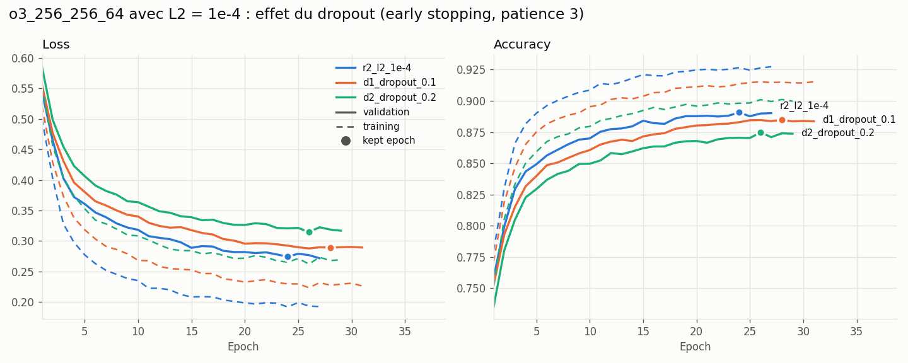

# Le dropout et le MC dropout

Ce document explique le dropout de `my_torch`, une autre façon de limiter l'overfitting que [la régularisation L2](regularisation.md), puis le MC dropout, qui s'en sert pour prédire, et ce qu'ils apportent au réseau d'échecs.

## Le principe

À chaque batch d'entraînement, chaque neurone d'une couche avec dropout est **éteint au hasard**, avec une probabilité `p` : sa sortie vaut 0 pour ce batch. Les neurones éteints changent à chaque batch.

Un neurone ne peut donc pas compter sur la présence d'un autre neurone précis. Le réseau doit répartir ce qu'il apprend sur plusieurs neurones, au lieu de construire des combinaisons fragiles qui ne servent qu'à retenir des exemples d'entraînement. On peut aussi le voir comme l'entraînement d'un grand nombre de sous-réseaux qui partagent leurs poids.

**Le dropout n'est actif que pendant l'entraînement.** Pour prédire, tous les neurones servent, et le réseau donne toujours la même réponse pour la même position.

## L'inverted dropout

Si une couche perd en moyenne 20 % de ses sorties pendant l'entraînement, mais aucune en prédiction, la couche suivante reçoit des valeurs plus grandes que celles qu'elle a apprises. Pour corriger cet écart, les sorties **gardées** sont divisées par `1 - p` pendant l'entraînement :

```
masque = 0 avec la probabilité p, sinon 1 / (1 - p)
sortie = activation(Z) × masque
```

L'espérance de chaque sortie ne change pas : `(1 - p) × 1 / (1 - p) = 1`. En prédiction, il n'y a donc rien à corriger : le réseau se calcule exactement comme sans dropout. C'est la version utilisée par les bibliothèques actuelles.

## La backpropagation

La sortie gardée vaut `A × masque`. Sa dérivée par rapport à `A` est donc le masque lui-même :

```
dA = d(sortie) × masque
```

Un neurone éteint ne reçoit aucun gradient, et ses poids d'arrivée ne bougent pas pour ce batch. Un neurone gardé reçoit le gradient multiplié par `1 / (1 - p)`, comme sa sortie. Le masque est gardé en mémoire pendant le forward pour servir au backward, comme les entrées des couches.

Un test compare ce gradient à des différences finies, avec un masque fixé, à 1e-10 près.

## Dans `my_torch`

```python
network = Network(769, [(256, "relu"), (256, "relu"), (64, "relu"), (5, "identity")],
                  seed=0, dropout=[0.2, 0.2, 0.2, 0.0])
```

- **Un taux par couche,** appliqué après son activation. Il va de 0 inclus à 1 exclu : avec 1, la couche ne transmettrait plus rien.
- **Jamais sur la dernière couche.** Ses sorties sont les scores du réseau : en éteindre un reviendrait à retirer une classe au hasard.
- **Pas de dropout sur les entrées** du réseau d'échecs. Chacune dit si une pièce est sur une case : en éteindre une retire une pièce de l'échiquier, ce qui peut changer la position et donc le bon label.
- **Le hasard est reproductible.** `train` tire les masques avec un générateur à part, issu de sa graine. Le même entraînement redonne donc les mêmes poids. Comme ce générateur est distinct de celui du mélange, ajouter du dropout ne change pas l'ordre des exemples.
- **Les mesures de l'historique sont prises sans dropout,** avec tous les neurones, comme le réseau sera utilisé.

Dans [le fichier de configuration](configuration.md), le taux s'écrit sur la couche :

```toml
layers = [
    { size = 256, activation = "relu", dropout = 0.2 },
    { size = 5, activation = "identity" },
]
```

Les taux sont enregistrés dans [le fichier .nn](format_nn.md). Un fichier écrit avant l'ajout du dropout se charge toujours, sans dropout.

## Le MC dropout

Le MC dropout, pour « Monte Carlo dropout », garde le dropout **actif pour prédire**. Le réseau est calculé N fois sur la même position, avec des neurones éteints différents à chaque passe :

- **la prédiction** est la moyenne des N probabilités, obtenues par softmax des scores ;
- **l'écart-type** des N probabilités mesure à quel point la réponse dépend des neurones éteints. Un écart-type élevé signale une position sur laquelle le réseau est incertain.

```python
from my_torch import mc_dropout

mean, std = mc_dropout(network, inputs, passes=20, seed=0)
```

Le MC dropout demande un réseau entraîné avec du dropout : sans dropout, les N passes seraient identiques. Il coûte N fois le temps d'une prédiction.

Pour mesurer son effet sur un réseau d'échecs :

```
$> python3 -m scripts.evaluate --network net.nn --chessboards datasets/official_validation.txt \
       --mc-passes 20
```

`my_torch_analyzer --predict` n'utilise **pas** le MC dropout : il garde une seule passe, déterministe. Le MC dropout n'y serait ajouté que s'il gagnait nettement sur la validation, ce qui n'est pas le cas dans les mesures ci-dessous.

## Ce que ça donne sur le réseau d'échecs

Le réseau poussé, `o3_256_256_64` avec `l2 = 1e-4`, a été réentraîné avec un dropout de 0,1 puis de 0,2 sur ses trois couches cachées, avec le même early stopping que [la régularisation](regularisation.md) : `val_accuracy`, une patience de 3, et 40 epochs au plus. Les trois réseaux sont comparés sur la **validation** du dataset fourni, 71 556 positions :

| Configuration | Dropout | Epoch gardée | Entraînement | Validation 5 classes | Validation 2 classes | F1 macro | Écart |
|---|---|---|---|---|---|---|---|
| [r2_l2_1e-4](../configs/candidates/regularisation/r2_l2_1e-4.conf) | 0 | 24 | 92,7 % | **89,1 %** | **95,1 %** | **0,873** | 3,6 points |
| [d1_dropout_0.1](../configs/candidates/dropout/d1_dropout_0.1.conf) | 0,1 | 28 | 91,5 % | 88,5 % | 94,7 % | 0,868 | 3,0 points |
| [d2_dropout_0.2](../configs/candidates/dropout/d2_dropout_0.2.conf) | 0,2 | 26 | 90,1 % | 87,5 % | 93,9 % | 0,857 | 2,6 points |



**Ce qu'on en lit :**

- **Le dropout réduit bien l'overfitting :** l'écart entre l'entraînement et la validation passe de 3,6 à 3,0 puis 2,6 points.
- **Mais il fait baisser la validation,** de 0,6 point avec 0,1 et de 1,6 point avec 0,2. Le réseau régularisé par L2 n'overfittait déjà plus beaucoup : le dropout le gêne pour apprendre plus qu'il ne l'aide à généraliser. L'entraînement lui-même plafonne plus bas, signe d'un début d'**underfitting**.
- **Le dropout ralentit l'apprentissage :** à chaque epoch, la validation est en dessous de celle du réseau sans dropout, et l'early stopping s'arrête plus tard.

**Le MC dropout** a été mesuré sur les deux réseaux avec dropout, avec 20 passes :

| Réseau | Une passe, sans dropout | MC dropout, 20 passes |
|---|---|---|
| d1_dropout_0.1 | 88,47 % | 88,46 % |
| d2_dropout_0.2 | 87,47 % | 87,40 % |

**Il ne gagne rien en précision,** et coûte 20 fois le temps d'une prédiction. L'inverted dropout fait déjà de la passe sans dropout une bonne approximation de la moyenne des sous-réseaux.

**Son écart-type, en revanche, mesure bien l'incertitude.** Sur la validation, avec `d1_dropout_0.1`, les positions sont triées par l'écart-type de la probabilité de la classe prédite :

| Positions | Précision | Écart-type moyen |
|---|---|---|
| Les 10 % les plus sûres | 99,9 % | 0,004 |
| Les 50 % les plus sûres | 95,6 % | 0,032 |
| Toutes | 88,4 % | 0,090 |
| Les 10 % les moins sûres | 83,5 % | 0,238 |

Les erreurs ont un écart-type moyen de 0,129, contre 0,085 pour les bonnes réponses. Le réseau sait donc, en partie, quand il risque de se tromper. Le sujet ne demande qu'un label par position : cette information n'est pas utilisée par `--predict`.

Ces mesures se refont avec :

```
$> python3 -m scripts.compare_configs --train datasets/official_train.txt \
       --validation datasets/official_validation.txt --json datasets/dropout.json \
       --save datasets/dropout_networks configs/candidates/dropout/*.conf
$> python3 -m scripts.evaluate --network datasets/dropout_networks/d1_dropout_0.1.nn \
       --chessboards datasets/official_validation.txt --mc-passes 20
```

**Le choix : pas de dropout dans le réseau poussé.** Il reste celui de [la régularisation L2](regularisation.md), le meilleur sur toutes les mesures de validation.

## Comment c'est vérifié

**Les calculs.** [tests/test_dropout.py](../tests/test_dropout.py) compare le gradient avec dropout à des différences finies, avec un masque fixé. Il vérifie la part des neurones éteints et la mise à l'échelle des neurones gardés, qu'un réseau sans générateur est déterministe et n'utilise pas un ancien masque, et que les taux invalides sont refusés.

**L'entraînement.** Le même entraînement avec dropout redonne les mêmes poids, des poids différents de ceux d'un entraînement sans dropout, dans le même ordre d'exemples ; des taux nuls donnent exactement le réseau sans dropout ; les mesures de l'historique sont prises sans dropout.

**La configuration et le fichier .nn.** Lecture et refus des taux, aller-retour par un fichier `.nn`, et chargement d'un fichier écrit avant le dropout.

**Le MC dropout.** Moyennes et écarts-types, reproductibilité avec une graine, convergence vers la passe sans dropout avec beaucoup de passes, et l'évaluation par `scripts.evaluate --mc-passes`.

**La détection des erreurs.** 29 erreurs ont été introduites volontairement dans le code, comme oublier la mise à l'échelle `1 / (1 - p)`, ignorer le masque dans la backpropagation, réutiliser le générateur du mélange, ou rendre la variance au lieu de l'écart-type dans le MC dropout. Les tests les ont toutes détectées.

Ces tests se lancent avec `make tests_run`.
