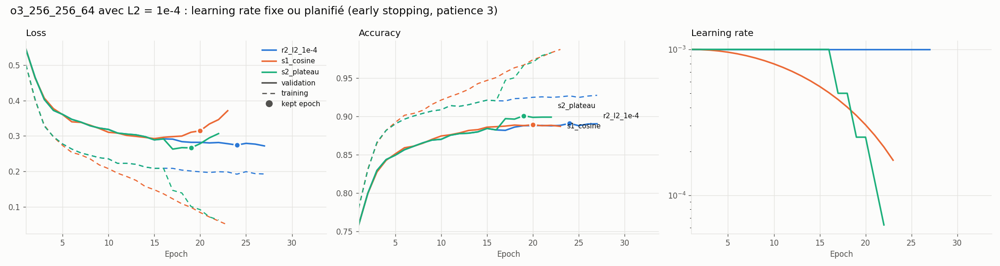

# La planification du learning rate

Ce document explique comment `my_torch` fait évoluer le learning rate pendant un entraînement, puis ce que ça apporte au réseau d'échecs.

## Le problème

Le learning rate fixe la taille de chaque pas de l'optimiseur. Un même learning rate convient rarement à tout l'entraînement :

- **au début,** les poids sont loin d'un bon minimum : de grands pas les en rapprochent vite ;
- **à la fin,** les poids sont près d'un minimum : de grands pas les font osciller autour, sans jamais s'y poser. Un mini-batch ne donne qu'une estimation bruitée du gradient, et ce bruit est multiplié par le learning rate.

Commencer grand puis diminuer combine les deux : on avance vite, puis on affine. Les grands pas du début aident aussi à ne pas rester dans le premier creux venu du coût, ce que demande l'issue : un minimum local étroit peut être franchi d'un seul pas.

## Les cinq plannings

Le learning rate de l'optimiseur sert de départ, noté `lr` ci-dessous. L'epoch `e` va de 1 au nombre d'epochs `E`.

| Planning | Learning rate de l'epoch `e` | Paramètres, et valeur par défaut |
|---|---|---|
| `multistep` | `lr × factor ^ (nombre de milestones ≤ e)` : divisé aux epochs choisies | `factor = 0.5`, `milestones = [10]` |
| `step` | `lr × factor ^ ⌊(e - 1) / every⌋` : divisé par paliers | `factor = 0.5`, `every = 10` |
| `exponential` | `lr × factor ^ (e - 1)` : un peu plus petit à chaque epoch | `factor = 0.9` |
| `cosine` | `minimum + (lr - minimum) × (1 + cos(π (e - 1) / E)) / 2` | `minimum = 0` |
| `plateau` | multiplié par `factor` quand `monitor` ne progresse plus depuis `patience` epochs, sans descendre sous `minimum` | `factor = 0.5`, `patience = 2`, `monitor = "val_loss"`, `minimum = 0` |

- **`step`, `multistep` et `exponential`** suivent un calendrier fixé d'avance. Il faut deviner quand le réseau aura besoin de pas plus petits.
- **`cosine`** descend lentement au début, vite au milieu, et de nouveau lentement à la fin. Il ne demande que la valeur finale, et s'adapte au nombre d'epochs.
- **`plateau`** réagit à ce qui se passe vraiment : il ne réduit le learning rate que quand la mesure surveillée cesse de progresser, sur l'entraînement (`loss`, `accuracy`) ou sur la validation (`val_loss`, `val_accuracy`).

`factor` est strictement entre 0 et 1 : le learning rate ne peut que baisser.

## Dans `my_torch`

```python
from my_torch import get_schedule, train

history = train(network, loss, optimizer, inputs, targets, epochs=30, batch_size=64,
                validation=(validation_inputs, validation_targets),
                schedule=get_schedule("plateau", factor=0.5, patience=1, monitor="val_accuracy"))
```

- **Avant chaque epoch,** `train` demande au planning le learning rate de l'epoch, et le donne à l'optimiseur. Tous les optimiseurs ont un `learning_rate` : le planning marche avec chacun d'eux.
- **L'historique garde le learning rate de chaque epoch,** sous `learning_rate`, et l'affichage le montre :

```
epoch 17/30 - loss 0.1464 - accuracy 0.9469 - val_loss 0.2628 - val_accuracy 0.8969 - learning_rate 0.0005
```

- **L'optimiseur retrouve son learning rate de départ à la fin,** même si l'entraînement s'arrête sur une erreur. Le fichier `.nn` garde donc le learning rate de la configuration, et un nouvel entraînement repart du même planning.
- **Le learning rate d'une epoch ne dépend que des epochs précédentes.** `plateau` ne garde aucune mémoire à part : il relit l'historique à chaque epoch. Le même entraînement suit donc toujours les mêmes learning rates, et un planning se teste sans entraîner de réseau.
- **Un planning sur la validation demande un jeu de validation.** Sans lui, `train` refuse de commencer.

## Avec l'early stopping

Le planning et [l'early stopping](regularisation.md) peuvent surveiller la même mesure. La patience du planning doit alors être plus courte que celle de l'early stopping : le learning rate baisse d'abord, ce qui relance souvent la progression, et l'entraînement ne s'arrête que si même un plus petit learning rate ne sert plus à rien.

`cosine` est calculé sur le nombre d'epochs prévu. Si l'early stopping arrête l'entraînement avant, le learning rate n'a pas atteint son minimum.

## Dans la configuration et `--train`

Le planning s'écrit dans la section `[training]` du [fichier de configuration](configuration.md), sur une ligne :

```toml
schedule = { name = "step", factor = 0.5, every = 10 }
```

ou dans sa propre table, plus lisible avec beaucoup de paramètres :

```toml
[training.schedule]
name = "plateau"
factor = 0.5
patience = 1
monitor = "val_accuracy"
```

Sans `schedule`, le learning rate reste fixe. Chaque paramètre est vérifié, et un paramètre inconnu est refusé :

```
invalid configuration 'network.conf': training.schedule: unknown key 'gamma'
```

Le planning est enregistré dans [le fichier .nn](format_nn.md), avec tous ses paramètres, et `my_torch_analyzer --train` le suit. Un planning sur la validation demande alors `validation_split`, sinon `--train` s'arrête avant d'avoir rien modifié :

```
my_torch_analyzer: the plateau schedule on val_loss needs a validation set: set validation_split in the training settings
```

**Reprendre un entraînement recommence le planning.** Chaque lancement de `--train` repart de l'epoch 1, avec le learning rate de la configuration.

## Ce que ça donne sur le réseau d'échecs

Le réseau poussé, `o3_256_256_64` avec `l2 = 1e-4`, a été entraîné avec deux plannings, toujours avec l'early stopping sur `val_accuracy` et une patience de 3. Ils sont comparés sur la **validation** du dataset fourni au même réseau à learning rate fixe, celui de [la régularisation](regularisation.md) :

| Configuration | Planning | Epoch gardée | Entraînement | Validation 5 classes | Validation 2 classes | F1 macro |
|---|---|---|---|---|---|---|
| [r2_l2_1e-4](../configs/candidates/regularisation/r2_l2_1e-4.conf) | fixe, 0,001 | 24 | 92,7 % | 89,07 % | 95,1 % | 0,873 |
| [s1_cosine](../configs/candidates/schedule/s1_cosine.conf) | `cosine`, de 0,001 à 0,00001 sur 30 epochs | 20 | 97,4 % | 88,88 % | 95,1 % | 0,870 |
| [s2_plateau](../configs/candidates/schedule/s2_plateau.conf) | `plateau` sur `val_accuracy`, `factor = 0.5`, `patience = 1` | 19 | 96,6 % | **90,06 %** | **95,8 %** | **0,883** |



Le troisième panneau montre le learning rate de chaque epoch, en échelle logarithmique.

**Ce qu'on en lit :**

- **Le planning plateau gagne un point de validation.** Jusqu'à l'epoch 16, il suit exactement le learning rate fixe, et donne donc exactement le même réseau. L'epoch 16 ne progresse pas : le learning rate est divisé par 2, et la validation passe de 88,2 % à **89,7 %** dès l'epoch suivante. Une deuxième baisse, après l'epoch 18, mène à 90,06 %.
- **C'est le mécanisme décrit plus haut :** à 0,001, les poids oscillaient autour d'un minimum sans s'y poser. Des pas plus petits les y font descendre, ce que montre la chute du coût d'entraînement et de validation à l'epoch 17.
- **Le cosine ne gagne rien ici.** Il baisse le learning rate dès le début, ce qui accélère l'apprentissage de l'entraînement, mais pas la validation : l'écart se creuse jusqu'à 8,5 points, et l'early stopping s'arrête à l'epoch 23, avant que le learning rate ne devienne petit.
- **Les deux plannings overfittent davantage :** un learning rate plus petit laisse le réseau mieux apprendre l'entraînement, jusqu'à 96,6 % pour le plateau. L'early stopping reste donc indispensable.

**Le choix : le planning plateau.** Le réseau poussé doit pouvoir être refait par `my_torch_analyzer --train`, qui n'a pas de jeu de validation. Le plateau a divisé le learning rate avant les epochs 17 et 19 : le planning `multistep` avec ces paliers redonne exactement les mêmes learning rates, donc le même réseau :

```toml
epochs = 19
schedule = { name = "multistep", factor = 0.5, milestones = [17, 19] }
```

Ses résultats sur le test sont dans [le document du réseau final](reseau_final.md).

La comparaison se refait avec :

```
$> python3 -m scripts.compare_configs --train datasets/official_train.txt \
       --validation datasets/official_validation.txt --json datasets/learning_rate.json \
       configs/candidates/schedule/*.conf
$> python3 -m scripts.plot_history --json datasets/learning_rate.json \
       --output docs/images/learning_rate.png
```

## Comment c'est vérifié

**Les plannings.** [tests/test_schedules.py](../tests/test_schedules.py) vérifie les valeurs de chaque planning epoch par epoch, le replay du plateau (attente, remise à zéro après un progrès, minimum, sens d'amélioration selon la mesure), que `multistep` redonne les learning rates d'un plateau, et le refus des paramètres invalides.

**L'entraînement.** Un entraînement planifié fait exactement les mêmes pas qu'une suite d'entraînements d'une epoch au learning rate de chaque epoch. L'optimiseur retrouve son learning rate de départ, même après une erreur ; le planning et l'early stopping fonctionnent ensemble ; un planning sur une mesure absente est refusé avant de toucher au réseau.

**La configuration, le fichier .nn et les scripts.** Lecture et refus de la clé `schedule`, aller-retour par un fichier `.nn`, `--train` qui suit le planning sauvegardé et refuse un plateau sur la validation sans `validation_split`, et `compare_configs` qui enregistre le learning rate de chaque epoch.

**La détection des erreurs.** 38 erreurs ont été introduites volontairement dans le code, comme décaler le palier de `step` d'une epoch, laisser le plateau voir la mesure de l'epoch en cours, ne pas rendre son learning rate à l'optimiseur, ou partir du learning rate courant au lieu de celui de départ. Les tests les ont toutes détectées.

Ces tests se lancent avec `make tests_run`.
