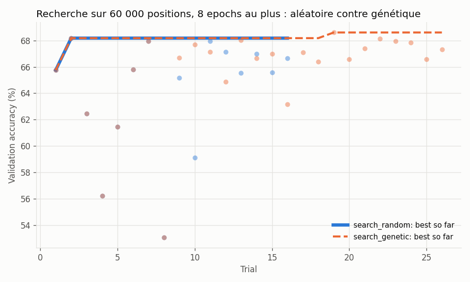

# La recherche d'hyperparamètres

Ce document explique comment `my_torch` cherche de bons hyperparamètres au lieu de les régler à la main, avec une recherche aléatoire et un algorithme génétique, puis ce que la recherche a donné sur le réseau d'échecs.

## Le problème

Les poids d'un réseau s'apprennent par la backpropagation. Ses **hyperparamètres**, eux, se choisissent avant l'entraînement : le nombre et la taille des couches, l'activation, le learning rate, la taille des batchs, la force de la régularisation L2, le taux de dropout. Aucun gradient ne dit comment les changer : la seule façon de juger un jeu d'hyperparamètres est d'entraîner le réseau et de le mesurer sur la **validation**.

Chaque essai coûte un entraînement. Il faut donc choisir les essais avec soin, et garder une trace de chacun.

## L'espace de recherche

L'espace de recherche dit quelles valeurs chaque hyperparamètre peut prendre. Il s'écrit en TOML, comme [configs/search/space.toml](../configs/search/space.toml) :

```toml
[space]
hidden = { choice = [[128], [256, 64], [256, 256, 64], [512, 128], [512, 256, 64]] }
activation = { choice = ["relu", "leaky_relu", "tanh"] }
learning_rate = { log_uniform = [0.0001, 0.01] }
batch_size = { choice = [32, 64, 128, 256] }
l2 = { choice = [0.0, 0.00001, 0.0001, 0.001] }
dropout = { choice = [0.0, 0.1, 0.2] }
```

| Type | Valeurs | Tirage |
|---|---|---|
| `choice` | une liste de valeurs, de n'importe quel type | chaque valeur a la même chance |
| `log_uniform` | `[bas, haut]`, deux nombres positifs | uniforme sur le logarithme, arrondi à 3 chiffres significatifs |
| `int_range` | `[bas, haut]`, deux entiers | chaque entier de `bas` à `haut` inclus |

**Pourquoi `log_uniform` pour le learning rate.** Passer de 0,0001 à 0,001 change autant l'entraînement que passer de 0,001 à 0,01. Un tirage uniforme entre 0,0001 et 0,01 tomberait 9 fois sur 10 au-dessus de 0,001. Le tirage logarithmique donne la même chance à chaque puissance de dix.

Les hyperparamètres absents de l'espace viennent de la **configuration de base**, par défaut celle du réseau poussé. Toutes les couches cachées reçoivent la même activation et le même dropout.

## La recherche aléatoire

Elle tire chaque hyperparamètre au hasard, entraîne le réseau, et recommence. Elle paraît naïve, mais elle est difficile à battre avec peu d'essais : contrairement à une grille, elle essaie une valeur différente de chaque hyperparamètre à chaque essai. Quand un seul hyperparamètre compte vraiment, 20 essais aléatoires en testent 20 valeurs, là où une grille de 20 essais sur 3 hyperparamètres n'en teste que 2 ou 3.

Les tirages sont fixés par la graine. Un jeu tiré deux fois n'est entraîné qu'une fois.

## L'algorithme génétique

Il s'inspire de la sélection naturelle : une **population** de jeux d'hyperparamètres évolue de **génération** en génération, et les meilleurs transmettent leurs valeurs.

1. **La première génération** est tirée au hasard, puis chaque jeu est entraîné et mesuré : son score est sa précision de validation.
2. **L'élitisme :** les `elite` meilleurs jeux passent tels quels à la génération suivante. Le meilleur score ne peut donc jamais baisser d'une génération à l'autre.
3. **La sélection par tournoi :** pour choisir un parent, on tire 3 jeux de la génération au hasard, et on garde le meilleur. Les bons jeux sont souvent choisis, mais les autres gardent une chance, ce qui préserve la diversité.
4. **Le croisement :** l'enfant de deux parents prend chaque hyperparamètre de l'un ou de l'autre, à pile ou face.
5. **La mutation :** chaque hyperparamètre de l'enfant change avec une probabilité de 0,3, et au moins un change. Un `choice` prend une autre valeur de sa liste, un `log_uniform` est multiplié par un facteur aléatoire d'environ 0,5 à 2, un `int_range` bouge d'un ou deux pas. La mutation apporte des valeurs qu'aucun parent n'avait.
6. **On recommence** jusqu'à la dernière génération.

Le croisement réunit ce qui marche chez deux bons jeux, et la mutation explore autour. Là où la recherche aléatoire répartit ses essais partout, l'algorithme génétique concentre les siens autour des meilleurs jeux trouvés.

## Le script

```
$> python3 -m scripts.search_hyperparameters --space configs/search/space.toml \
       --train datasets/official_train.txt --validation datasets/official_validation.txt \
       --train-size 60000 --validation-size 20000 --epochs 8 --patience 2 \
       --output datasets/search.jsonl random --trials 20
$> python3 -m scripts.search_hyperparameters ... genetic --population 8 --generations 4
```

- **Chaque essai est court :** il s'entraîne sur une part fixe du jeu d'entraînement, avec l'early stopping sur `val_accuracy`, et il est mesuré sur une part fixe de la validation. Le classement sert à choisir des hyperparamètres, que l'on entraîne ensuite sur tout le dataset.
- **Chaque essai est sauvegardé dès qu'il finit,** une ligne JSON par essai dans `--output` : ses hyperparamètres, son score, l'epoch gardée, l'accuracy d'entraînement et sa durée.
- **Une recherche interrompue reprend où elle s'était arrêtée :** relancer la même commande relit le fichier, et n'entraîne que les essais qui manquent. Les essais d'une recherche servent aussi de cache à une autre, sur le même fichier.
- **Le résultat est reproductible :** les tirages, les parts des données et les entraînements sont tous fixés par la graine.
- **À la fin, le script affiche le classement** de tous les essais du fichier, du meilleur score au moins bon.

## Ce que la recherche a donné

Les deux recherches ont exploré l'espace ci-dessus sur 60 000 positions d'entraînement et 20 000 de validation, avec 8 epochs au plus et une patience de 2. Chaque essai a pris de 20 secondes à 10 minutes.

| Recherche | Essais | Meilleur score | Meilleur jeu |
|---|---|---|---|
| Aléatoire, 16 tirages | 16 | 68,18 % | `[128]`, `relu`, learning rate 0,00669, batch 256, `l2` 1e-4, dropout 0,1 |
| Génétique, 4 générations de 8 | 26 | **68,61 %** | `[128]`, `leaky_relu`, learning rate 0,00153, batch 64, `l2` 1e-4, dropout 0,2 |

Les deux recherches avaient la même graine : la première génération de l'algorithme génétique est donc exactement le même tirage que les 8 premiers essais aléatoires. Les deux méthodes partent ainsi des mêmes points. L'algorithme génétique n'a entraîné que 26 jeux au lieu de 32, car les jeux de l'élite, et ceux qu'il retrouvait, n'étaient pas réentraînés.



Un point par essai, et une ligne avec le meilleur score trouvé jusque-là.

**Ce qu'on en lit :**

- **L'algorithme génétique concentre ses essais sur les bonnes régions.** La moyenne des nouveaux essais passe de 62,6 % dans la première génération, tirée au hasard, à 66,9 % et 66,5 % dans les deux suivantes, puis 67,5 % dans la dernière. Ses essais tardifs sont presque tous au-dessus de 66 %, alors que la recherche aléatoire continue de tomber sur de mauvais jeux, jusqu'à 59 %.
- **Il trouve le meilleur jeu,** mais de peu : 0,4 point. Avec 26 essais et un score mesuré sur 20 000 positions, cet écart reste fragile.
- **Les petits réseaux gagnent** dans ces conditions : le meilleur jeu des deux recherches est un réseau `[128]`.

**Des tendances nettes ressortent** sur les 34 jeux différents essayés, par la moyenne de leurs scores :

| Hyperparamètre | Moyenne des essais |
|---|---|
| Activation | `relu` 67,4 %, `leaky_relu` 66,8 %, `tanh` **62,2 %** |
| `l2` | 0 : 66,3 %, 1e-5 : 66,3 %, 1e-4 : 66,6 %, 1e-3 : **62,2 %** |
| Batch | 32 : **62,1 %**, 64 : 65,5 %, 128 : 66,6 %, 256 : 66,8 % |
| Couches cachées | `[128]` **67,2 %**, `[256, 64]` 66,0 %, `[512, 256, 64]` 65,1 %, `[512, 128]` 62,0 % |

`tanh`, une L2 de 1e-3 et des batchs de 32 sont nettement moins bons. Les 10 meilleurs jeux de l'algorithme génétique ont tous un `l2` de 1e-4, comme le réseau poussé. Le dropout ne change presque rien à la moyenne.

## Le classement tient-il avec toutes les données ?

Une recherche courte favorise les réseaux qui apprennent **vite**, pas forcément ceux qui finissent le **mieux**. Avec 60 000 positions, les grands réseaux overfittent en quelques epochs, alors qu'un petit réseau n'en a pas la capacité. Les deux meilleurs jeux ont donc été entraînés sur **tout** le dataset fourni, avec l'early stopping, 40 epochs au plus :

| Configuration | Recherche, 60 000 positions | Tout le dataset, validation | Epoch gardée |
|---|---|---|---|
| [t1_genetic](../configs/candidates/search/t1_genetic.conf), `[128]` | 68,61 % | 81,52 % | 13 |
| [t2_random](../configs/candidates/search/t2_random.conf), `[128]` | 68,18 % | 79,61 % | 15 |
| Le réseau poussé à learning rate fixe, `[256, 256, 64]` | 66,10 % | **89,07 %** | 24 |

**Le classement s'inverse.** Avec 572 449 positions, le réseau de 128 neurones plafonne vers 81 % : il n'a pas assez de capacité pour tout le dataset. Le réseau à 3 couches, moins bon sur 60 000 positions, gagne 7,5 points avec toutes les données. Le chiffre de 66,10 % vient du [benchmark des architectures](benchmarks.md), dans des conditions proches de la recherche : les mêmes 60 000 positions et 8 epochs, mais sans early stopping.

**Le réseau poussé ne change donc pas.** La recherche reste utile pour éliminer les mauvais choix, comme `tanh` ou une L2 trop forte, mais ses résultats se vérifient sur le dataset complet avant d'être retenus. Une recherche plus fidèle demanderait des essais sur tout le dataset, de 10 minutes à 2 heures chacun : quelques dizaines d'essais prendraient plusieurs jours.

Les essais se refont avec les commandes ci-dessus, et la vérification avec :

```
$> python3 -m scripts.compare_configs --train datasets/official_train.txt \
       --validation datasets/official_validation.txt configs/candidates/search/*.conf
$> python3 -m scripts.plot_search --output docs/images/recherche.png \
       datasets/search_random.jsonl datasets/search_genetic.jsonl
```

## Comment c'est vérifié

**La recherche.** [tests/test_search.py](../tests/test_search.py) vérifie que les tirages et les mutations restent dans leur espace, que le tirage logarithmique donne la même chance à chaque puissance de dix, qu'un jeu n'est évalué qu'une fois, le classement, la reprise d'une recherche, sa reproductibilité, et que l'élitisme ne perd jamais le meilleur jeu d'une génération.

**Le script.** Les hyperparamètres remplacent bien ceux de la configuration de base, un hyperparamètre inconnu est refusé, un essai est noté à son epoch gardée, et une recherche sur le réseau d'échecs sauvegarde, classe et reprend ses essais.

**La détection des erreurs.** 27 erreurs ont été introduites volontairement dans le code, comme exclure la borne haute d'un `int_range`, garder les pires jeux comme élite, ou noter un essai à sa dernière epoch. Les tests les ont toutes détectées.

Ces tests se lancent avec `make tests_run`.
