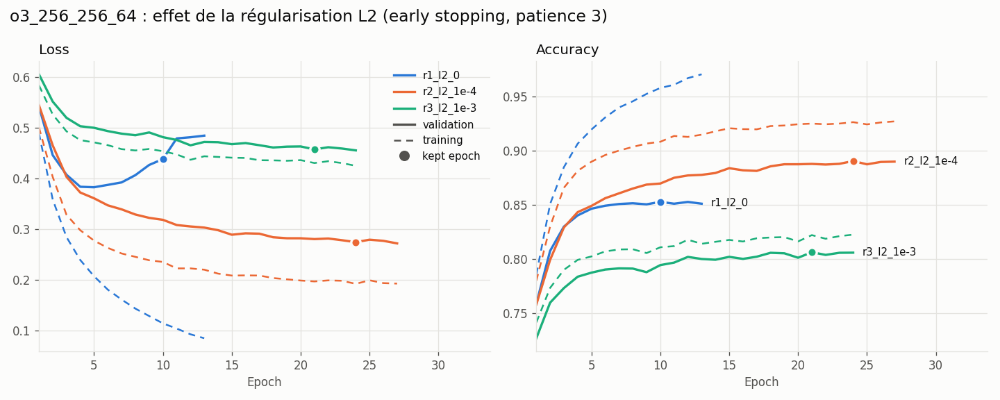

# La régularisation L2 et l'early stopping

Ce document explique les deux outils de `my_torch` contre l'overfitting, la régularisation L2 et l'early stopping, puis ce qu'ils apportent au réseau d'échecs.

## Le problème : l'overfitting

Après 10 epochs sur le dataset fourni, le réseau d'échecs faisait 95,8 % sur ses positions d'entraînement, mais 85,3 % sur la validation. Ces 10 points d'écart viennent de l'**overfitting** : le réseau apprend des détails propres aux positions qu'il voit, qui ne servent à rien sur les autres.

## La régularisation L2

**Le principe.** On ajoute au coût une pénalité qui grandit avec les poids :

```
coût total = coût des données + l2 / 2 × somme des carrés de tous les poids
```

Pour faire baisser ce coût, le réseau doit garder des poids petits, sauf s'ils aident vraiment à prédire. Un réseau aux poids petits produit des sorties qui varient doucement avec les entrées : il retient moins les particularités d'un exemple isolé.

**Le gradient.** La dérivée de `l2 / 2 × w²` est `l2 × w`. Il suffit donc d'ajouter `l2 × W` au gradient des poids de chaque couche, après la backpropagation et avant le pas de l'optimiseur :

```python
for layer in network.layers:
    layer.weights_gradient += l2 * layer.weights
```

Avec SGD, le pas devient `W ← W - lr × (gradient + l2 × W)` : à chaque pas, les poids sont aussi rapprochés de 0 d'une petite fraction. C'est pourquoi on parle aussi de **weight decay**. Un test vérifie ce gradient par différences finies du coût pénalisé.

**Les biais ne sont pas pénalisés.** Un biais décale la sortie d'un neurone, sans multiplier une entrée. Il ne rend pas le réseau plus sensible aux détails des exemples, et le pénaliser ne ferait que gêner l'apprentissage. C'est le choix habituel.

**L'historique garde le coût des données seul.** La pénalité dépend de `l2` : l'ajouter rendrait les courbes de deux réglages différents impossibles à comparer.

**Avec Adam.** Adam divise chaque gradient par une moyenne de ses valeurs passées. La pénalité ajoutée au gradient est donc, elle aussi, mise à l'échelle poids par poids. C'est la « régularisation L2 couplée », la plus simple, et celle que mesurent nos tests. Il en existe une variante, AdamW, qui applique le rétrécissement des poids à part ; elle n'est pas implémentée.

## L'early stopping

**Le principe.** La validation progresse d'abord, puis plafonne, puis peut se dégrader quand l'overfitting l'emporte. L'early stopping surveille une mesure de validation à la fin de chaque epoch, et arrête l'entraînement quand elle n'a pas progressé depuis `patience` epochs.

**Le retour à la meilleure epoch.** À chaque nouvelle meilleure valeur, `train` garde une copie des poids, des biais et de la mémoire de l'optimiseur. À l'arrêt, le réseau revient à cette copie. Sans ce retour, on garderait les poids des `patience` dernières epochs, qui ne progressent plus.

La mémoire de l'optimiseur, comme les moyennes d'Adam, est restaurée avec les poids. Un entraînement repris depuis le fichier sauvegardé repart ainsi exactement de la meilleure epoch : un test vérifie que le réseau obtenu est identique à un réseau entraîné jusqu'à cette epoch et pas plus loin.

**La mesure surveillée.** `monitor` vaut `val_loss` ou `val_accuracy`. Une meilleure valeur doit être strictement plus basse pour le coût, et strictement plus haute pour l'accuracy : à égalité, la première epoch est gardée.

```python
history = train(network, loss, optimizer, inputs, targets, epochs=30, batch_size=64, seed=0,
                validation=(validation_inputs, validation_targets), verbose=True,
                patience=3, monitor="val_accuracy")
```

Sur le dataset fourni, sans L2, la fin de l'affichage donne :

```
epoch 13/30 - loss 0.0849 - accuracy 0.9708 - val_loss 0.4842 - val_accuracy 0.8513
early stopping: best val_accuracy 0.8530 at epoch 10
```

L'historique garde toutes les epochs effectuées, y compris celles d'après la meilleure, pour qu'on puisse voir le plateau sur les courbes.

**Il faut un jeu de validation.** Sans lui, `train` refuse la patience. L'early stopping choisit l'epoch sur la validation : ce jeu ne doit donc pas être le jeu de test, qui ne sert qu'à la mesure finale.

## Dans la configuration et `--train`

| Clé de `[training]` | Rôle | Par défaut |
|---|---|---|
| `l2` | Force de la pénalité, positive ou nulle | `0`, sans pénalité |
| `patience` | Epochs sans progrès avant l'arrêt | Aucune, sans early stopping |
| `monitor` | `val_loss` ou `val_accuracy` | `val_loss` |
| `validation_split` | Part des positions que `--train` garde pour la validation | `0` |

`my_torch_analyzer --train` ne reçoit qu'un fichier de positions. Avec `validation_split`, il en met une part de côté, tirée au hasard avec la graine de l'entraînement, et s'en sert comme validation. Avec une patience mais sans `validation_split`, il s'arrête avec une erreur, avant d'avoir rien modifié :

```
my_torch_analyzer: early stopping needs a validation set: set validation_split in the training settings
```

Ces réglages sont enregistrés dans le fichier `.nn` avec les autres. Un fichier plus ancien, qui ne les contient pas, se charge avec leurs valeurs par défaut.

## Ce que ça donne sur le réseau d'échecs

La configuration du réseau poussé, `o3_256_256_64`, a été entraînée avec trois forces de L2, toujours avec l'early stopping sur `val_accuracy` et une patience de 3, jusqu'à 30 epochs au plus. Les trois runs sont comparés sur la **validation** du dataset fourni, 71 556 positions :

| Configuration | `l2` | Epochs faites | Epoch gardée | Entraînement | Validation 5 classes | Validation 2 classes | F1 macro | Durée |
|---|---|---|---|---|---|---|---|---|
| [r1_l2_0](../configs/candidates/regularisation/r1_l2_0.conf) | 0 | 13 | 10 | 95,8 % | 85,3 % | 92,7 % | 0,833 | 34 min |
| [r2_l2_1e-4](../configs/candidates/regularisation/r2_l2_1e-4.conf) | 0,0001 | 27 | 24 | 92,7 % | **89,1 %** | **95,1 %** | **0,873** | 167 min |
| [r3_l2_1e-3](../configs/candidates/regularisation/r3_l2_1e-3.conf) | 0,001 | 24 | 21 | 82,2 % | 80,6 % | 89,6 % | 0,783 | 76 min |

Les durées sont celles de trois runs lancés en même temps sur la même machine : seules leurs proportions comptent.



En pointillés l'entraînement, en trait plein la validation, et un point sur l'epoch gardée par l'early stopping.

**Ce qu'on en lit :**

- **Sans L2, l'overfitting arrive vite.** Le coût de validation est au plus bas dès l'epoch 5, puis remonte, alors que celui de l'entraînement continue de baisser. L'accuracy de validation plafonne vers 85 % à partir de l'epoch 7 : l'early stopping s'arrête à l'epoch 13 et garde l'epoch 10.
- **Avec `l2 = 1e-4`, le réseau apprend plus longtemps.** L'écart entre l'entraînement et la validation passe de 10,5 à 3,6 points, et la validation progresse jusqu'à l'epoch 24, pour finir **3,8 points au-dessus**. La pénalité empêche le réseau de retenir les positions d'entraînement, ce qui lui laisse le temps d'apprendre des règles qui marchent aussi sur les autres.
- **Avec `l2 = 1e-3`, la pénalité est trop forte.** Le réseau n'arrive même plus à bien apprendre l'entraînement, 82,2 %, et la validation est plus basse que sans L2 : c'est de l'**underfitting**.
- **Surveiller `val_accuracy` plutôt que `val_loss` était le bon choix ici.** Sans L2, le coût de validation remonte dès l'epoch 5, alors que l'accuracy progresse encore jusqu'à l'epoch 10. Le coût punit très fort les quelques erreurs commises avec assurance, et peut donc remonter alors que le nombre de bonnes réponses augmente encore. C'est ce nombre de bonnes réponses que mesure le correcteur.

**Le choix : `l2 = 1e-4`, entraîné 24 epochs.** C'est la meilleure configuration sur toutes les mesures de validation. Le réseau poussé est réentraîné avec ces réglages, sans patience : `--train` ne voit que le jeu d'entraînement, et 24 epochs redonnent exactement le réseau gardé par l'early stopping. [La planification du learning rate](learning_rate.md) a ensuite amélioré ce réseau ; les résultats du réseau poussé sur le test sont dans [le document du réseau final](reseau_final.md).

La comparaison se refait avec :

```
$> python3 -m scripts.compare_configs --train datasets/official_train.txt \
       --validation datasets/official_validation.txt --json datasets/regularisation.json \
       configs/candidates/regularisation/*.conf
$> python3 -m scripts.plot_history --json datasets/regularisation.json \
       --output docs/images/regularisation.png
```

## Comment c'est vérifié

**Les calculs.** [tests/test_training.py](../tests/test_training.py) compare le gradient avec L2 à des différences finies du coût pénalisé, vérifie que les biais ne sont pas pénalisés et que la pénalité rétrécit bien les poids. Pour l'early stopping, il vérifie l'epoch d'arrêt, le sens d'amélioration de chaque mesure, et que le réseau et l'optimiseur restaurés sont identiques à ceux d'un entraînement arrêté à la meilleure epoch.

**La configuration et `--train`.** [tests/test_config.py](../tests/test_config.py) et [tests/test_train.py](../tests/test_train.py) vérifient les valeurs acceptées et refusées, le découpage de `validation_split`, le refus d'une patience sans validation, et que les réglages enregistrés arrivent bien jusqu'à `train`.

**Les outils de mesure.** [tests/test_compare_configs.py](../tests/test_compare_configs.py) vérifie l'epoch gardée et l'accuracy d'entraînement de cette epoch, et [tests/test_plot_history.py](../tests/test_plot_history.py) que l'image est écrite et que les résultats invalides sont refusés.

**La détection des erreurs.** 37 erreurs ont été introduites volontairement dans le code, comme pénaliser aussi les biais, s'arrêter une epoch trop tôt, ne pas restaurer la mémoire de l'optimiseur, ou garder la dernière epoch au lieu de la meilleure dans la comparaison. Les tests les ont toutes détectées.

Ces tests se lancent avec `make tests_run`.
